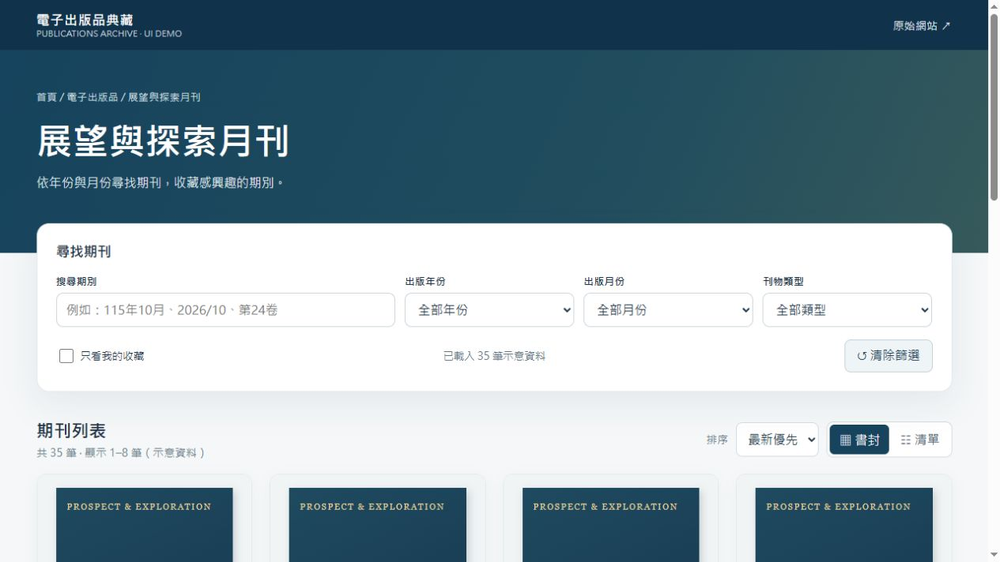

# 展望與探索月刊｜電子書櫃前端 Demo

以法務部調查局電子書櫃為參考的非官方介面設計示範。

## 使用方式

下載本儲存庫，直接使用瀏覽器開啟 `index.html`。無須安裝套件、建置工具、Python、Node.js、資料庫或後端服務。

## 功能

- 期別關鍵字搜尋，支援民國與西元日期的常見格式。
- 出版年份、月份與刊物類型篩選，以及可移除的條件標籤。
- 新舊排序、書櫃／清單切換、分頁與無結果提示。
- 期刊資訊視窗、本機收藏與僅看收藏。
- 響應式版面與可收合的投稿資訊。

## 資料與限制

35 筆期刊資料及封面均為展示用途，並非完整或經核實的官方館藏。詳情視窗尚未串接各期正式閱讀／下載連結，提供的外部連結通往官方書櫃。

所有互動均在瀏覽器內完成。收藏與檢視偏好儲存在瀏覽器的 `localStorage`；清除網站資料後會重設。此專案不包含後端或建置腳本。

